# OpenJewelleryBhy

CAO paramétrique open source pour la bijouterie, écrite en **Rust**, pour **Linux et Windows**.
Elle reprend les principes de MatrixGold (historique paramétrique, ring rails, builders de
gemmes, têtes, halos, pavé, cutters, poids de métal), mais avec un noyau autonome : pas de
Rhino, pas de licence.

> L'analyse du fonctionnement de MatrixGold, avec ses sources et ses preuves, est dans
> [docs/MATRIXGOLD_ANALYSIS.md](docs/MATRIXGOLD_ANALYSIS.md). Projet indépendant, sans lien
> avec Stuller, Gemvision ou McNeel. Aucun code ni asset de MatrixGold n'est utilisé.

## Installer

Les paquets sont dans les Releases du dépôt (ou dans `dist/` après `./scripts/package.sh`) :

| Système | Fichier | Installation |
|---|---|---|
| Windows 10/11 x64 | `OpenJewelleryBhy-<v>-windows-x64-setup.exe` | Double-clic. Installation par utilisateur, sans droits admin : raccourcis menu Démarrer et Bureau, fichiers `.ojb` associés, désinstallation via « Applications installées ». `/S` pour une installation silencieuse. |
| Windows (sans installation) | `OpenJewelleryBhy-<v>-windows-x64-portable.zip` | Décompresser, lancer `openjewellerybhy.exe`. |
| Linux x64 | `OpenJewelleryBhy-<v>-linux-x64.tar.gz` | `tar xzf …` puis `./install.sh` : menu des applications, icône, type MIME `.ojb`, commandes `openjewellerybhy` et `ojb`. `uninstall.sh` pour désinstaller. |

> Windows SmartScreen peut avertir au premier lancement, car l'exécutable n'est pas signé :
> « Informations complémentaires » → « Exécuter quand même ».

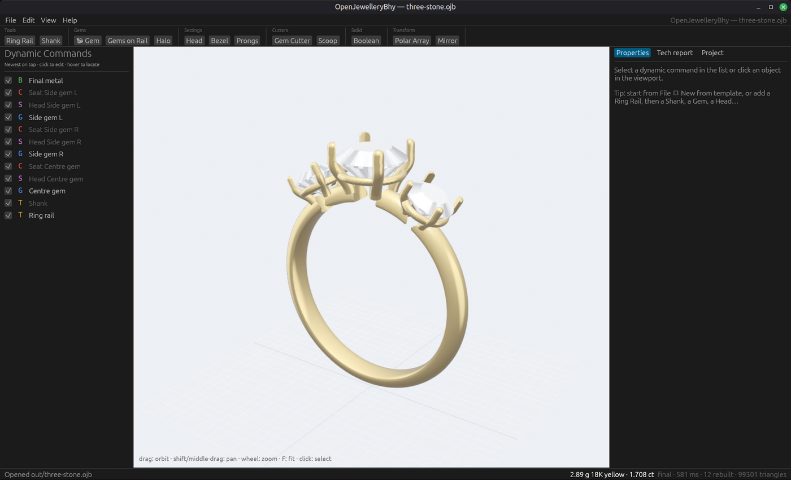

| Rendu photoréaliste (Render Studio) | | Poignées dans la vue 3D |
|---|---|---|
| 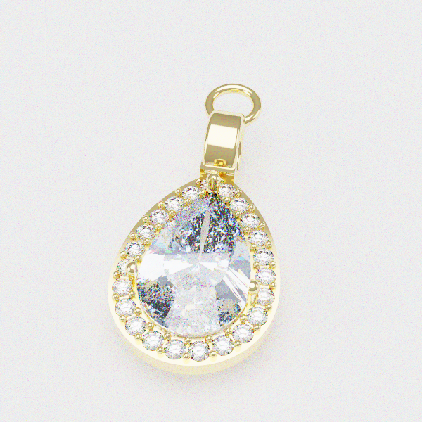 | 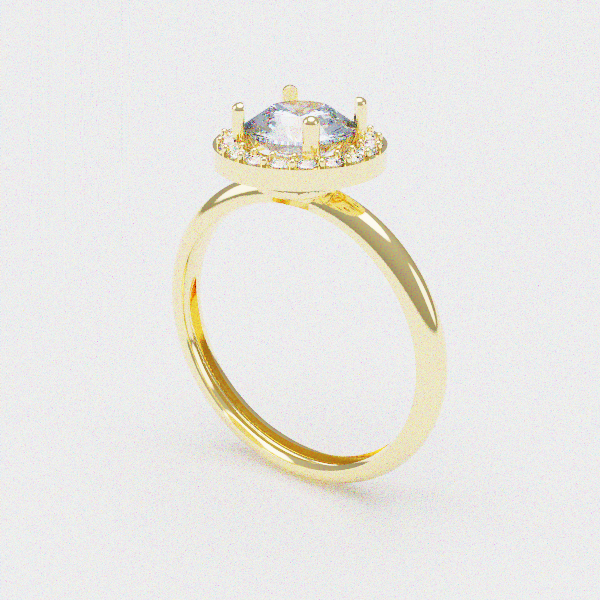 | 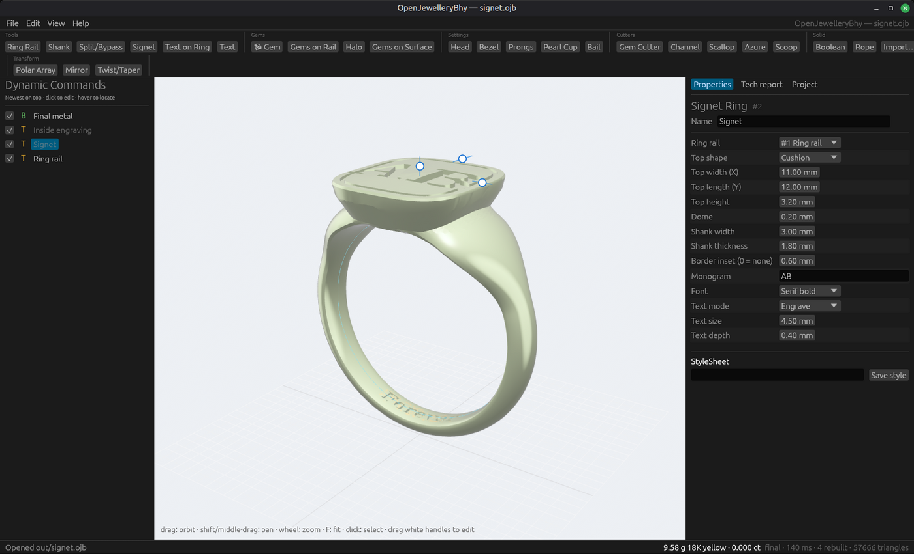 |

| Solitaire | Halo | Pavé | Éternité | Clos | Trois pierres |
|---|---|---|---|---|---|
| 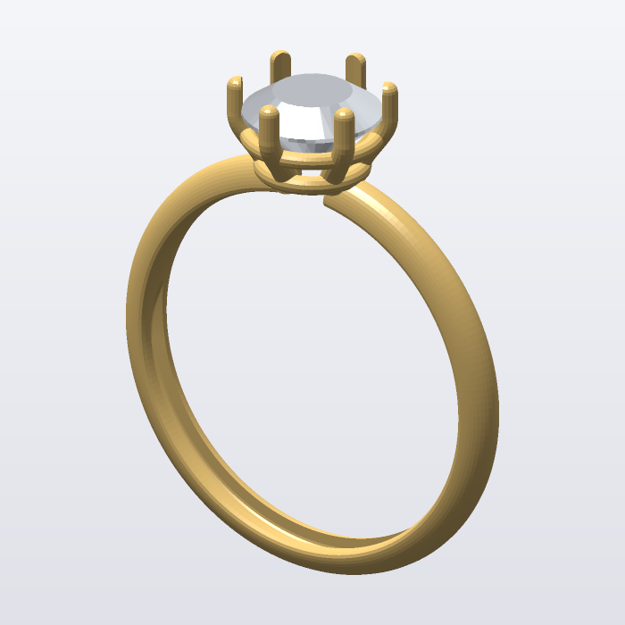 | 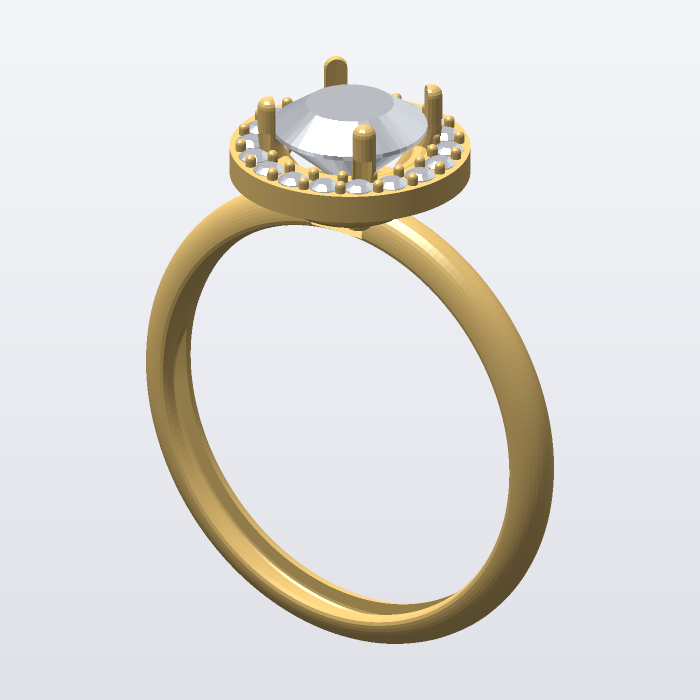 | 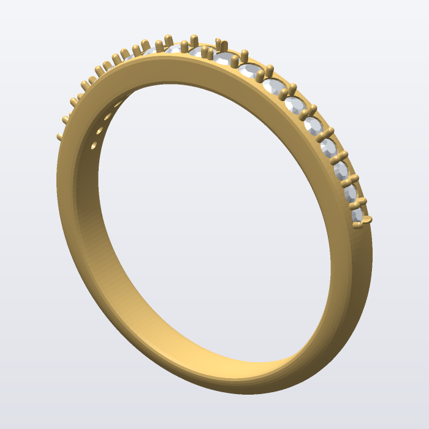 | 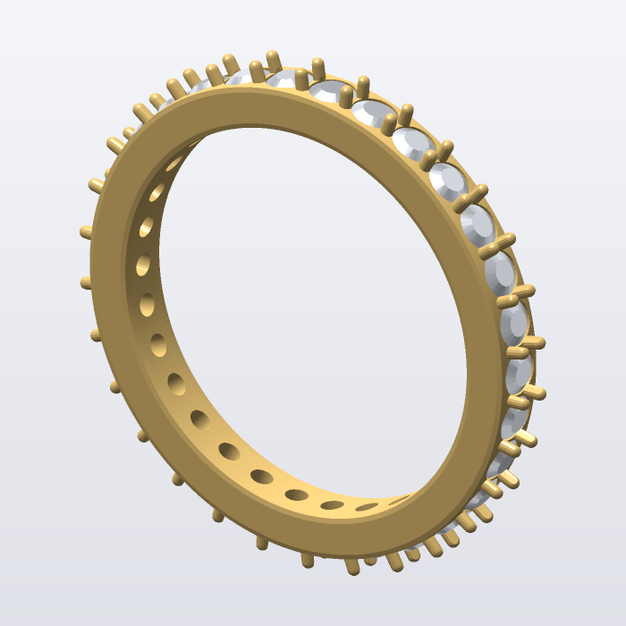 | 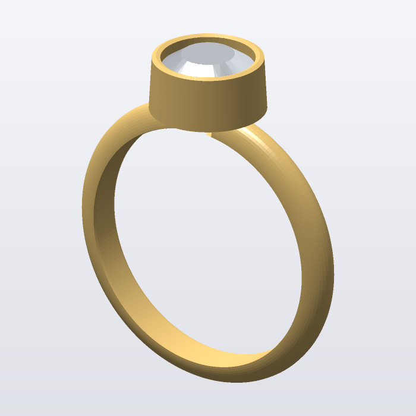 | 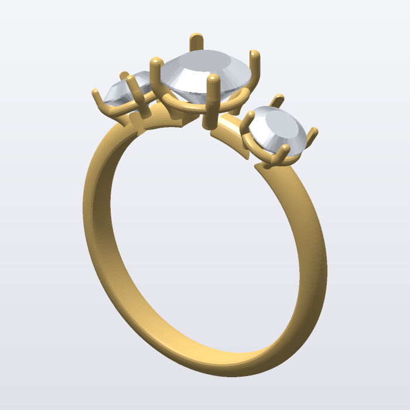 |

| Chevalière gravée | Pendentif halo + bélière | Corps fendu | Corde | Puce perle |
|---|---|---|---|---|
| 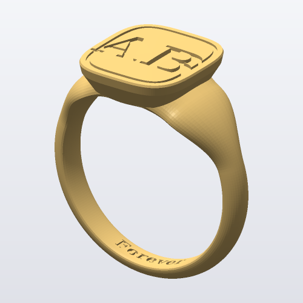 | 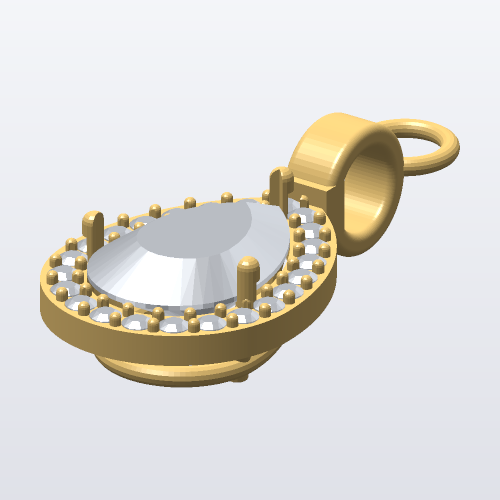 | 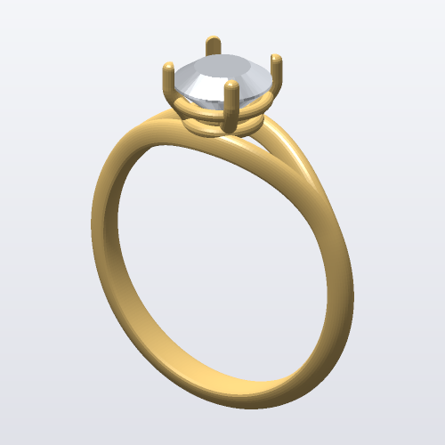 | 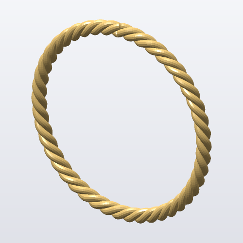 | 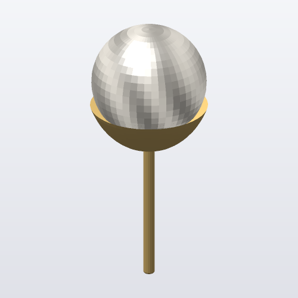 |

## Fonctionnalités

- **Historique paramétrique (« Dynamic Commands »)** : chaque étape est un nœud d'un graphe
  (DAG). Modifier un paramètre ne recalcule que ce nœud et ses descendants. Le cache est
  indexé par hachage du contenu, et les nœuds indépendants sont évalués en parallèle (rayon).
  Pendant qu'on fait glisser un curseur, un mode aperçu saute les booléens ; le calcul exact
  est relancé dès qu'on relâche.
- **Ring Rail** : 11 systèmes de tailles (US/CA, UK/AU avec lettres et demi-tailles,
  ISO/EU, FR, DE, CH/IT/ES, JP/CN, diamètre et circonférence en mm ou en pouces).
- **Shank** (Profile Placer + Sweep) : stations de profils (position, largeur, épaisseur,
  7 profils : demi-jonc, confort, plat, carré, fil rond, arête, court), interpolation lissée,
  symétrie. **Corps fendu** (*split shank*) et **croisé** (*bypass*). **Corde** torsadée.
- **Chevalière** (Award Ring Builder) : plateau de forme libre, dôme, bordure gravée,
  monogramme gravé ou en relief.
- **Texte** : gravé ou en relief à l'intérieur ou à l'extérieur de l'anneau, ou texte solide
  libre (polices DejaVu Sans et Serif intégrées).
- **Gemmes** : 21 formes (rond, ovale, coussin, princesse, émeraude, asscher, radiant,
  octogone, baguette, baguette effilée, marquise, poire, cœur, trillion droit et courbe,
  triangle, demi-lune, hexagone, losange, trapèze, cercueil) et des formes **personnalisées**
  à partir de n'importe quelle courbe fermée. Coupes brillant / à degrés / cabochon / perle,
  proportions table, couronne, rondiste et profondeur, 14 matières. Le carat est calculé de
  deux façons : volume exact du modèle × densité, et formules de l'industrie.
- **Placement** : gemme libre ou sur le rail ; **Gems on Rail** (pavé, rail, éternité,
  dégressif, Minimum/Fixed, miroir, plusieurs rangs) ; **Gems on Surface** (clic sur
  n'importe quelle surface, ou remplissage automatique d'une zone par échantillonnage de
  Poisson).
- **Sertis** : **Head** (2 à 12 griffes, courbure, base, nudge, dôme, gallery rails),
  **Bezel** (siège, épaisseurs, dôme), **Halo** (mêlée, cadre, griffes partagées),
  **Prong Placer** (griffes partagées / 2 / 4 par pierre), **Pearl Cup** (coupelle, tige,
  poussoir de boucle d'oreille), **Bail** (bélière et anneau de jonction).
- **Cutters** : sièges de gemmes, **Channel** (rail de sertissage), **Scallop** (festons de
  serti clos), **Azure** (ajours en nid d'abeille), **Scoop** (gorge d'allègement).
- **Booléens** robustes (union, différence, intersection) : découpe locale par BSP limitée à
  la zone de recouvrement des boîtes englobantes, puis classification par rayons votés. Les
  outils peuvent se chevaucher, comme c'est souvent le cas en pavé.
- **Transformations** : réseau polaire, miroir dynamique, **Twist** et **Taper**.
- **Import** STL et OBJ (en métal ou en cutter), maillage intégré au fichier `.ojb`.
- **Poignées dans la vue 3D** (*viewport control handles*) : taille de doigt, stations
  du corps, hauteur et position des pierres, griffes, halo, chevalière, texte…
- **Render Studio** : lancer de rayons progressif, or poli, gemmes réfractives avec
  dispersion (« feu »), éclairage de studio. Enregistrement en PNG.
- **Tech report** : poids pour 15 alliages en g et en dwt, volume calculé par union de rayons
  (pas de double comptage des pièces qui se recouvrent), surface, rapport gemmes
  (nombre, carats), tailles converties dans tous les systèmes. Export Markdown ou JSON.
- **StyleSheets** : presets de paramètres par type de builder.
- **Projet / Job bag** : client, designer, n° de job, statut, temps CAO, notes.
- **Export** : STL binaire, OBJ, **3MF** (métal seul ou avec gemmes) ; aperçus PNG
  (rendu logiciel, sans GPU).
- **11 modèles** : solitaire, halo, pavé, éternité, serti clos, trois pierres, chevalière,
  pendentif, corps fendu, corde, puce perle.
- **Interface** : egui + wgpu (Vulkan/DX12/Metal/GL), MSAA 4×, sélection par clic,
  annuler/rétablir, raccourcis.

## Compiler

Prérequis : Rust stable (`rustup`). Sous Linux, une pile graphique Vulkan ou OpenGL ;
pour compiler : `libxkbcommon-dev libwayland-dev libx11-dev` (Debian/Ubuntu).

```bash
cargo build --release
```

Paquets de release (Linux → Windows en compilation croisée, via
[zig](https://ziglang.org) et `cargo install cargo-zigbuild`) :

```bash
./scripts/package.sh
```

Binaires produits par `cargo build --release` :
- `target/release/openjewellerybhy` (`.exe` sous Windows) : l'application ;
- `target/release/ojb` : la ligne de commande.

Sous Windows : installez Rust (MSVC) puis lancez la même commande. La CI GitHub
([.github/workflows/ci.yml](.github/workflows/ci.yml)) construit et teste Linux et Windows et
publie les binaires.

## Ligne de commande

```bash
ojb templates                                   # liste des 11 modèles
ojb new halo -o bague.ojb --size N½ --region uk --shape oval --gem 7 --alloy "platinum 950"
ojb build bague.ojb -o bague.3mf --gems        # export impression / fonte
ojb report bague.ojb                           # poids, carats, tailles (Markdown, ou --json)
ojb render bague.ojb -o apercu.png             # aperçu rapide sans GPU
ojb render bague.ojb -o rendu.png --pathtrace --spp 128   # rendu photoréaliste
ojb size 54 --from iso                         # conversions de tailles
ojb gem --shape pear --width 6 --length 9      # calculateur de carats
ojb bench halo                                 # mesures de performance
```

## Performances (Linux, 12 threads, `--release`)

| Opération (modèle halo) | Temps |
|---|---|
| Évaluation complète, booléens compris | ~650 ms |
| Changement de taille de doigt (tout l'historique suit) | ~390 ms |
| Réévaluation sans changement (cache) | 0,02 ms |
| Tech report (union par rayons, 500×500) | ~18 ms |
| Rendu PNG logiciel 700 px | ~60 ms |
| Rendu photoréaliste 600 px, 96 échantillons | ~4,5 s |

## Architecture

```
crates/
  ojb-core/   noyau sans dépendance graphique
    mesh.rs        maillages f64, loft, tubes, balayages
    csg.rs         booléens + volume d'union + tests d'appartenance
    outline.rs     contours des 21 formes de gemmes
    gem.rs         modèles de gemmes, carats
    profile.rs     profils d'anneau
    sizes.rs       systèmes de tailles
    materials.rs   alliages et densités
    ops/           builders (rail, shank, gems, head, bezel, halo, prongs, cutters, boolean, transform)
    document.rs    DAG, sérialisation .ojb, évaluateur incrémental parallèle
    report.rs      tech report
    io.rs          .ojb, STL, OBJ, 3MF
    render.rs      rendu logiciel PNG
    templates.rs   modèles prêts à l'emploi
  ojb-cli/    `ojb`
  ojb-app/    application egui/wgpu (thread de calcul séparé, scène GPU incrémentale)
  ojb-setup/  installeur Windows autonome (payload zip intégré)
scripts/package.sh, packaging/linux/   paquets de release
```

Conventions (identiques à MatrixGold) : millimètres, +Z vers le haut, rail dans le plan XZ,
doigt selon Y, gemme avec le rondiste à l'origine et la table vers +Z.

## Limites connues

- La géométrie est maillée, pas en NURBS : il n'y a pas d'import ni d'export `.3dm` Rhino.
  On échange avec Rhino et MatrixGold en STL, OBJ ou 3MF.
- Pas de modélisation organique SubD (l'équivalent de Clayoo).
- Les exécutables Windows ne sont pas signés (avertissement SmartScreen).
